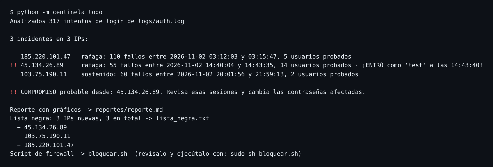
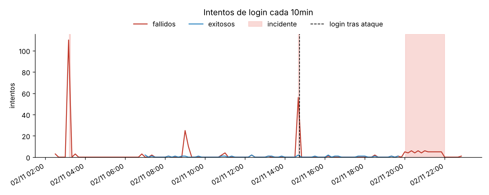
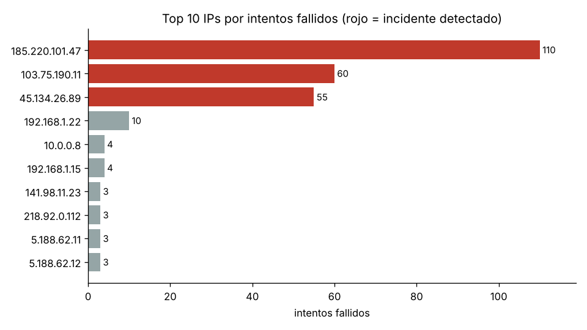
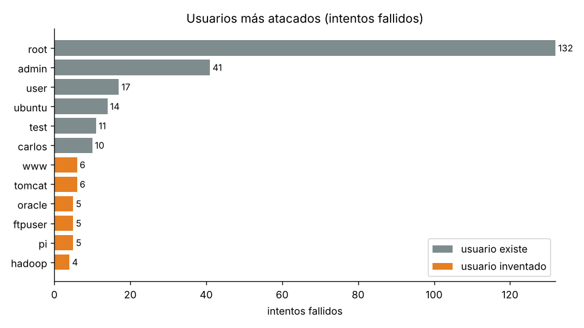

# Centinela

Detector de ataques de fuerza bruta en logs de SSH, escrito en Python como proyecto de aprendizaje de ciberseguridad.

Centinela lee el archivo de autenticación de un servidor Linux (`/var/log/auth.log`), encuentra las IPs que intentan adivinar contraseñas, avisa si alguna llegó a entrar, genera un reporte con gráficos y mantiene una lista negra con su script de firewall.



## Curso interactivo

En [`curso/index.html`](curso/index.html) tienes un curso en español basado en este repositorio. Son 13 módulos (logs, expresiones regulares, detección, token bucket, pandas, lista negra, pytest, hash, TCP, firewall, cifrado asimétrico, man-in-the-middle y ética), con quizzes, laboratorios interactivos, las figuras de `figuras/` incrustadas, un glosario con buscador y un examen final.

Para verlo, abre `curso/index.html` en el navegador desde tu copia del repositorio: las figuras se cargan desde las carpetas vecinas. El progreso se guarda solo en tu navegador.

## Instalación

Necesitas Python 3.10 o superior.

```bash
python -m pip install -r requirements.txt
```

## Uso rápido

```bash
python -m centinela generar      # crea logs/auth.log de ejemplo
python -m centinela todo         # detecta, crea el reporte y la lista negra
```

Todos los comandos (añade `-h` a cualquiera para ver sus opciones):

| Comando | Fase | Qué hace |
|---|---|---|
| `generar` | 1 | Crea un log SSH realista (`--dias`, `--semilla`, `--formato iso`). |
| `intentos [LOG] [--ip IP]` | 1 | Tabla con fecha, IP, usuario y resultado de cada intento. |
| `detectar [LOG]` | 2 | Lista los incidentes de fuerza bruta. |
| `reporte [LOG]` | 3 | CSVs, tres gráficos PNG y `reportes/reporte.md`. |
| `bloquear [LOG]` | 4 | Actualiza `lista_negra.txt` y escribe `bloquear.sh`. |
| `todo [LOG]` | 2+3+4 | Todo lo anterior de una vez. |

Para analizar un log real, pásale la ruta y el año (el formato clásico de syslog no guarda el año):

```bash
sudo cp /var/log/auth.log mi_auth.log && sudo chown $USER mi_auth.log
python -m centinela todo mi_auth.log --anio 2026
```

## Estructura

```
centinela/
├── generador.py    Fase 1 · logs de ejemplo con 4 tipos de ataque
├── parser.py       Fase 1 · regex -> objetos Intento
├── detector.py     Fase 2 · ventana deslizante por IP
├── reporte.py      Fase 3 · pandas + matplotlib
├── lista_negra.py  Fase 4 · lista negra, lista blanca y script iptables
├── cli.py          línea de comandos (python -m centinela ...)
└── __main__.py
tests/              59 tests con pytest (19 de seguridad)
fase1/              los scripts originales de la Fase 1, para comparar
logs/auth.log       log de ejemplo (semilla 42)
docs/img/           capturas de este README
```

Cada módulo empieza con una explicación en español de qué hace y por qué, y el código está comentado paso a paso.

## Fase 1 · Leer los logs

`generador.py` fabrica un día de actividad de un servidor `srv-web01`:

| Actor | IP | Qué hace |
|---|---|---|
| 5 usuarios legítimos | 192.168.x / 10.0.x | Entran en horario laboral y a veces se equivocan 1-2 veces. Carlos falla 4 veces seguidas. |
| Ataque **ráfaga** | `185.220.101.47` | 110 contraseñas de diccionario en 4 minutos contra root, admin… |
| Ataque **enumeración** | `45.134.26.89` | Prueba 55 usuarios inventados… y **entra** con la cuenta `test`. |
| Ataque **lento** | `103.75.190.11` | Un intento cada 90-150 s durante 2 horas. |
| **Botnet** | `5.188.62.10-21` | 12 IPs con 2-3 intentos cada una. |
| Escáneres | varias | 1-3 intentos y se van. |
| Ruido | — | CRON, sudo, cierres de sesión, `Invalid user`… |

`parser.py` usa una expresión regular con grupos con nombre (`(?P<ip>...)`) para reconocer solo las líneas `Accepted` y `Failed`, en formato clásico (`Nov  2 03:12:05`) o ISO (`2026-11-02T03:12:05+00:00`). Valida además la IP con el módulo `ipaddress`, porque la regex por sí sola aceptaría `999.1.1.1`.

## Fase 2 · Detectar la fuerza bruta

Una persona falla 1, 2, quizá 4 veces; un programa falla decenas de veces en poco tiempo. Para cada IP, `detector.py` mueve una **ventana de tiempo** sobre sus fallos y salta una alerta cuando dentro de la ventana hay al menos *umbral* fallos. Lleva dos reglas:

| Regla | Por defecto | Para qué |
|---|---|---|
| `rafaga` | 5 fallos en 60 s | Ataques rápidos. Opciones `--umbral` y `--ventana`. |
| `sostenido` | 20 fallos en 1 h | Ataques lentos que esquivan la primera regla. Opciones `--umbral-sostenido` y `--ventana-sostenida`. |

Las alertas que se solapan se fusionan en un **incidente**, con su inicio, su fin, el número de fallos y los usuarios probados. Si la IP consigue un login exitoso después de empezar el ataque, el incidente se marca como **comprometido** (`!!`). Es lo primero que hay que revisar.

Resultado sobre el log de ejemplo: se detectan los tres atacantes y el compromiso de `45.134.26.89`, sin ningún falso positivo con los usuarios legítimos (Carlos y sus 4 fallos quedan por debajo del umbral).

**Limitación (a propósito):** la botnet no se detecta, porque cada una de sus IPs solo falla 2-3 veces. En la línea de tiempo se ve como el pico de las 09:00. Es el ejercicio 3.

## Fase 3 · Reporte con pandas y matplotlib

`reporte.py` convierte los intentos en un `DataFrame` de pandas, los agrupa por IP con `groupby().agg()` y cuenta los intentos por intervalo de tiempo con `resample()`. `python -m centinela reporte` deja en `reportes/`:

- `intentos.csv`, `resumen_por_ip.csv` e `incidentes.csv` (se abren con Excel o LibreOffice),
- `reporte.md` con el resumen y las tablas,
- y estos tres gráficos:



Los picos rojos son los ataques y las zonas sombreadas los incidentes detectados. La línea discontinua marca el login del atacante. Fíjate en el pico de las 09:00: es la botnet, que el detector no ve.





En naranja aparecen los usuarios que no existen en el servidor, la huella típica de un ataque de enumeración.

## Fase 4 · Lista negra automática

`python -m centinela bloquear` hace tres cosas:

1. Filtra las IPs con incidentes según una **lista blanca**. Por defecto nunca se bloquean las redes privadas (`10.0.0.0/8`, `172.16.0.0/12`, `192.168.0.0/16`, `127.0.0.0/8`). Puedes añadir más redes con `--permitir 203.0.113.0/24`.
2. **Fusiona** las IPs con `lista_negra.txt` sin duplicados ni pérdidas, anotando el motivo en cada línea.
3. Escribe `bloquear.sh` con una orden `iptables` por IP. Las órdenes son *idempotentes* (`-C … || -I …`): se pueden ejecutar varias veces sin repetir reglas.

> Centinela **no ejecuta** el script. Bloquear tráfico en un servidor es delicado: revísalo y lánzalo tú con `sudo sh bloquear.sh`. En la vida real, herramientas como `fail2ban` hacen esto de forma continua.

## Tests

```bash
python -m pytest
```

Hay 59 tests que cubren el parser (formatos, ruido, IPs imposibles, cambio de año), las reglas del detector (justo en el umbral, por debajo, ataques lentos, compromisos), la lista blanca, la fusión de la lista negra, que el script no admita texto que no sea una IP, el reporte completo y la línea de comandos de principio a fin.

## Seguridad

Centinela pasó una auditoría de seguridad: 9 vulnerabilidades corregidas (2 altas, 4 medias, 3 bajas), cada una con su test en `tests/test_seguridad.py`. El informe completo, en español, está en [SEGURIDAD.md](SEGURIDAD.md). La lección principal: en un log, el nombre de usuario lo escribe el atacante.

## Ejercicios propuestos

1. **Regla por usuario:** añade una regla que avise cuando un mismo *usuario* recibe muchos fallos, aunque vengan de IPs distintas.
2. **Umbral a medida:** ejecuta `detectar --umbral 3 --ventana 30`. ¿Aparece Carlos como falso positivo? ¿Qué umbral elegirías y por qué?
3. **Cazar la botnet:** detecta "más de 10 IPs distintas fallando contra root en 15 minutos". Pista: `groupby` + `resample` en pandas.
4. **Modo vigilancia:** lee el log en bucle, como `tail -f`, y avisa en cuanto aparezca un incidente nuevo.

## Uso responsable

Analiza solo logs de sistemas que sean tuyos o que tengas permiso para revisar. Las IPs del log de ejemplo son inventadas para practicar.
